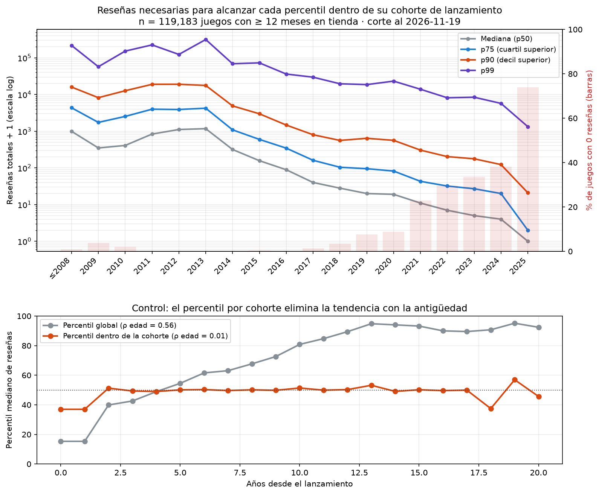
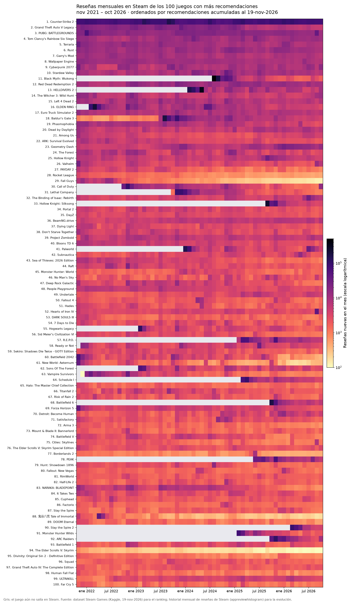

# Análisis exploratorio de datos

Resumen del EDA unificado. Las secciones 1 a 12 salen de `notebooks/02_eda.ipynb`; las tablas están en `reports/metrics/02_eda_*.csv` y las figuras en `reports/figures/02_eda_*.png` (se generan al ejecutar el notebook). La sección 13 reúne los análisis complementarios de los notebooks 02a a 02d y la sección 14 los hallazgos de los EDA individuales. Este texto es la base de la §6 del reporte (tarea S1-R3): al pasarlo al reporte hay que convertirlo en prosa continua, numerar tablas y figuras e interpretarlas.

> [!info] Versión de datos
> Todas las cifras de las secciones 1 a 12 usan la **versión congelada del 2026-11-24** (acuerdo A-008). Las cifras de la sección 13 se calcularon originalmente con la descarga del 2026-11-19 (150,199 filas) y se marcan como tales hasta que los notebooks 02a a 02d se vuelvan a ejecutar con el archivo congelado (acuerdo A-012).

Las columnas y su momento (Id, Pre, Pre\*, Post) están descritas en el [diccionario de datos](02-diccionario-datos.md). Lo que se hará con cada una está en la [estrategia de limpieza](04-estrategia-limpieza.md).

## Notebooks

| Notebook | Contenido |
|---|---|
| [02_eda](../notebooks/02_eda.ipynb) | EDA unificado: calidad, variable objetivo y muestra, deriva temporal, predictores, historial del desarrollador, auditoría de fuga y hallazgos |
| [02a_antiguedad_resenas](../notebooks/02a_antiguedad_resenas.ipynb) | Antigüedad del juego vs volumen de reseñas |
| [02b_percentiles_cohorte](../notebooks/02b_percentiles_cohorte.ipynb) | Percentiles dentro de la cohorte de lanzamiento |
| [02c_resenas_genero_categoria](../notebooks/02c_resenas_genero_categoria.ipynb) | Mediana de reseñas por género y por categoría |
| [02d_evolucion_top100](../notebooks/02d_evolucion_top100.ipynb) | Evolución mensual de los 100 juegos con más recomendaciones |

## 1. Resumen del conjunto

- **Fuente:** *Steam Games Dataset – All Games* (Hubert Sidorowicz, Kaggle, licencia MIT), con datos de Steam Store y SteamSpy. Se actualiza a diario.
- **Versión congelada:** descarga del 24-nov-2026, **151,023 juegos** y 33 columnas (42 originales menos 9 columnas pesadas). `app_id` es único.
- **Problema de reproducibilidad resuelto:** los cuatro EDA individuales se hicieron con descargas distintas (145,257; 150,199; 150,643 y 151,023 filas), por eso sus cifras no coincidían (p. ej., entre 62,178 y 67,929 juegos sin reseñas). Desde aquí todo el equipo usa un único archivo, verificado con `carga.verificarVersion`.
- **Archivo de reseñas:** `steam_games_reviews.csv` contiene citas de prensa del 9 % de los juegos, no reseñas de usuarios; no se usa.
- **Lectura del archivo:** hay que usar `keep_default_na=False`; si no, pandas convierte en nulo el nombre del juego «NULL» y el texto «None» de `notes`.
- **Disponibilidad temporal de las columnas:** 11 columnas son posteriores al lanzamiento (reseñas, propietarios estimados, jugadores simultáneos, tiempos de juego, Metacritic, etc.), 5 son «Pre\*» (precio, categorías, idiomas, DLC: el valor es el de la tienda hoy) y el resto se conoce antes del lanzamiento.

## 2. Calidad de los datos

**Faltantes.** Un faltante puede ser nulo, texto vacío, lista `[]` o un 0 que significa «sin dato». Contando las cuatro formas (Figura 1): `user_score` 99.9 %, tiempos de juego 94–99 %, `metacritic_score` 97 %, `peak_ccu` 87 %, `recommendations` 85 %, `full_audio_languages` 79 %, `achievements` 18 %, `estimated_owners` 14 % y alrededor de 6 % en `developers`, `publishers`, `genres`, `categories` e idiomas (las mismas filas). Las columnas posteriores al lanzamiento son las más vacías.

**Filas que se eliminan** (tabla del embudo, `02_eda_embudo_filas.csv`):

| Paso | Juegos |
|---|---:|
| Archivo congelado | 151,023 |
| Fecha de lanzamiento inválida | −82 |
| Precio atípico (2 registros de 107,500 USD, ambos de 2026) | −2 |
| No son videojuegos (software, video) | −1,555 |
| **Universo limpio (todos los años)** | **149,384** |
| Lanzados después de 2024 (D-002) | −53,480 |
| **Universo hasta 2024** | **95,904** |
| Con menos de 50 reseñas | −67,196 |
| **Muestra de modelado** | **28,708** |

Otros precios altos (16,000 y 1,900 USD) son de 2025–2026 y D-002 los excluye de todos modos.

**Formato mixto.** `genres` y `categories` vienen como lista de textos u objetos con `description`; el cambio ocurre alrededor de 2019–2020. Es un artefacto de la recolección: la diferencia de `pct_pos` entre formatos (0.759 contra 0.824) casi desaparece al comparar dentro del mismo año (diferencia de +0.007). Decisión: leerlos con `parsers.aLista` y no usar el formato como variable (Figura 2).

**Idiomas.** `supported_languages` trae, en 28,319 juegos, un solo texto HTML con marcas (y un asterisco para el doblaje completo) o con comas. Se resuelve con `parsers.idiomasYAudio`; sin esa corrección, esos juegos contarían como si tuvieran un solo idioma.

> [!warning] Ceros sospechosos en 2021–2024
> Entre 22 % y 38 % de los juegos de 2021–2024 no tiene reseñas aunque llevan de 2 a 5 años en tienda. Puede ser falta de exposición o datos de SteamSpy sin actualizar. Está pendiente comparar una muestra contra la tienda (ver Pendientes).

## 3. Variable objetivo y muestra

**Objetivo.** `pct_pos = positive / (positive + negative)`, definido solo con reseñas. El 21 % del universo hasta 2024 no tiene ninguna.

**Umbral mínimo de reseñas** (`02_eda_umbrales.csv`, Figura 3):

| Umbral | Juegos hasta 2024 | % del universo | Desv. de pct_pos |
|---:|---:|---:|---:|
| 1 | 75,799 | 79.0 | 0.238 |
| 10 | 52,663 | 54.9 | 0.180 |
| 30 | 35,378 | 36.9 | 0.162 |
| **50** | **28,708** | **29.9** | **0.156** |
| 100 | 21,424 | 22.3 | 0.148 |
| 500 | 9,961 | 10.4 | 0.130 |

La dispersión cae con rapidez hasta unas 50 reseñas; después mejora poco y la muestra se reduce. Propuesta: 50 como valor principal y sensibilidad a 30 y 100.

**Distribución.** En la muestra, media 0.782, mediana 0.817, desviación 0.156, asimetría −1.06; el 5 % de los juegos está por debajo de 0.47 y el 5 % superior por encima de 0.97. Es asimétrica a la izquierda: conviene reportar MAE además de RMSE.

**Tres definiciones de éxito** (Figura 4). `pct_pos` y el límite inferior de Wilson casi coinciden con ≥50 reseñas (Spearman 0.974); el percentil por cohorte elimina la tendencia temporal por construcción. Propuesta: `pct_pos` como objetivo principal y la etiqueta de «cuartil superior de su cohorte» (25 % de la muestra) como objetivo de clasificación secundario.

**Sesgo de selección** (Figura 5). La oferta crece de 2,461 lanzamientos en 2015 a 19,748 en 2024, pero la proporción que llega a 50 reseñas cae de 77 % a 16 %. La muestra describe juegos que lograron cierta tracción, no el catálogo completo; es una limitación que debe declararse. Excluir 2025–2026 elimina casi todos los juegos con menos de 12 meses, por lo que D-002 cubre la regla de antigüedad mínima. El 79 % de la muestra tiene 4 años o más.

## 4. Deriva temporal y partición

La media de `pct_pos` por año de lanzamiento sube de 0.713 (2014) a 0.834 (2024) (Figura 6). Una partición aleatoria mezclaría épocas y sobreestimaría el desempeño, así que se propone partición temporal 70/15/15 por fecha de lanzamiento:

| Conjunto | Juegos | Desde | Hasta | Media |
|---|---:|---|---|---:|
| Train | 20,098 | 1997-06-30 | 2021-11-01 | 0.764 |
| Valid | 4,311 | 2021-11-02 | 2023-08-02 | 0.815 |
| Test | 4,299 | 2023-08-03 | 2024-12-31 | 0.831 |

Predecir la media del train en el test da RMSE = 0.150 con un sesgo de +0.067; la desviación del test es 0.135. Cualquier modelo debe superar estas referencias, y el sesgo debe reportarse. La «tasa base de la cohorte» (hipótesis nula) se evalúa con la media del año anterior, no con la del propio año.

## 5. Predictores disponibles antes del lanzamiento

Las comparaciones usan la muestra (≥50 reseñas, hasta 2024) y `dif_cohorte` (diferencia contra la media de su año). Valores positivos indican mejor recepción que su cohorte.

- **Precio (Figura 7).** Relación no lineal (H3): 5–20 USD por encima de su cohorte (+0.012 a +0.016), menos de 5 USD y gratis alrededor de −0.01, y 40 USD o más en −0.027. Spearman entre log-precio y `dif_cohorte`: +0.044. Es el precio actual, no el del lanzamiento.
- **Plataformas y mes (Figura 8).** Casi todo es Windows (100 % en la muestra). Mac y Linux se asocian con mejor recepción (+0.052 y +0.053 en `dif_cohorte`; Spearman ≈ 0.15), por lo que H6 («la plataforma aporta poco») no se sostiene; probablemente son un proxy del esfuerzo del estudio. El mes de lanzamiento varía poco (rango de 0.02).
- **Géneros (Figura 9).** 33 géneros tras normalizar. *Massively Multiplayer* (−0.108) y *Early Access* (−0.068) son los más rezagados; *Casual* (+0.010) el mejor entre los frecuentes. *Early Access* y *Free To Play* se comportan distinto del tipo de juego, lo que respalda separar marketing de género. El número de géneros por juego se asocia negativamente con la recepción (Spearman −0.12).
- **Categorías (Figura 10).** 66 categorías, 36 con al menos 1 % de los juegos. Mejor: *Remote Play on TV* (+0.056), *Steam Workshop*, *Steam Leaderboards*, *Steam Cloud*, *Full controller support*. Peor: *Online Co-op* y *Online PvP* (−0.041), *PvP* y *Multi-player* (H5). *Steam Trading Cards* se excluye porque Steam la activa según las ventas.
- **Idiomas (Figura 11).** Una vez contados correctamente (143 idiomas base, pendientes de normalizar nombres traducidos), la asociación con la recepción es débil: Spearman +0.055 con `pct_pos` y +0.011 con `dif_cohorte`. H4 solo se sostiene de forma leve (11 o más idiomas: +0.010 contra −0.004 para 1 idioma).
- **Ficha.** Tener logros: +0.044 sobre no tenerlos. Sitio web, URL de soporte, correo y aviso adulto: diferencias menores a 0.02.

## 6. Historial del desarrollador y del publisher (Figura 12)

El nombre no se usa (94,211 desarrolladores y 79,912 publishers, casi todos con un solo juego). Se derivan variables del historial **solo con el pasado** y, además, **solo con juegos con al menos 12 meses de antigüedad**, porque las reseñas de un juego reciente siguen acumulándose después de su lanzamiento.

| Variable | Con juegos previos | Con historial calificado | Spearman vs `pct_pos` |
|---|---:|---:|---:|
| Desarrollador, sin regla de madurez | 46.5 % | 42.1 % | 0.540 |
| **Desarrollador, 12 meses de madurez** | 46.5 % | 32.5 % | **0.475** |
| Publisher, 12 meses de madurez | 59.1 % | 46.1 % | 0.451 |

Es el predictor con mayor asociación (H1; Spearman con `dif_cohorte` de 0.43), pero solo el 33 % de la muestra tiene historial calificado. La regla de madurez baja la correlación y la cobertura: es el costo de evitar fuga. Los juegos sin historial (*cold start*) necesitan un indicador. El historial del publisher y el del desarrollador son muy parecidos (Spearman 0.82). El 63 % de los juegos está autopublicado. Se reportará el modelo con y sin esta variable, y se evaluará también con partición agrupada por desarrollador.

## 7. Auditoría de fuga (variables POST, Figura 13)

Spearman con `pct_pos` entre los juegos de la muestra: `metacritic_score` 0.58 (13.8 % de cobertura), `recommendations` 0.22, `peak_ccu` 0.15, `estimated_owners` 0.14 y tiempos de juego cerca de 0. `user_score` correlaciona 0.997, pero existe en apenas 0.2 % de los juegos. Se excluyen todas como predictoras (solo `positive` y `negative` construyen el objetivo), y también `tags` y `dlc_count`.

## 8. Variables «Pre\*» (Figura 14)

El valor guardado es el de la tienda al 24-nov-2026, no el del lanzamiento. Si los juegos exitosos reciben después traducciones y contenido, la señal podría ser consecuencia del éxito. Resultado por año de lanzamiento (todos los juegos 2012 → 2024):

| Variable | 2012 | 2024 |
|---|---:|---:|
| Precio mediano (USD) | 9.99 | 3.99 |
| % de juegos gratuitos | 6.9 | 26.1 |
| Idiomas (promedio) | 4.35 | 7.06 |
| Categorías (promedio) | 5.45 | 3.63 |
| % con sitio web | 88.7 | 29.6 |

Las categorías, los logros y el sitio web son más frecuentes en los juegos viejos (posible acumulación posterior o supervivencia de los títulos que siguen en la tienda); los idiomas y los juegos gratuitos aumentan en los recientes. En todos los casos hay un efecto de época que se controla en parte comparando contra la cohorte. La valoración definitiva del riesgo es la **ablación** (modelo con y sin Pre\*) del Sprint 2.

## 9. Relaciones entre predictores (Figura 15)

Los pares más correlacionados son `log_precio` con `precio_pct_cohorte` (0.98) y el historial del desarrollador con el del publisher (0.82); hay que elegir cuál conservar. Correlación con `dif_cohorte`: historial del desarrollador 0.43, historial del publisher 0.40, Mac 0.17, Linux 0.15, logros 0.12, número de géneros −0.12 y el resto menor a 0.1.

## 10. Hallazgos y decisiones

La tabla completa de 17 hallazgos con su evidencia y la decisión para el pipeline está en `reports/metrics/02_eda_hallazgos.md` (y al final del notebook). Los puntos principales:

1. Una sola versión de datos congelada.
2. Muestra de 28,708 juegos (≥50 reseñas, hasta 2024); sensibilidad a 30 y 100.
3. Objetivo `pct_pos`; la partición debe ser temporal porque la recepción sube con los años.
4. Historial del desarrollador con regla de madurez de 12 meses: la señal más fuerte, con cobertura limitada.
5. Excluir todas las variables POST.
6. Variables Pre\* con reserva y ablación en el Sprint 2.
7. Mac, Linux, logros, categorías de calidad de producto y mercado multijugador en línea: señales moderadas; idiomas y mes: débiles.

## 11. Limitaciones

- Asociación, no causalidad: son datos observacionales de una sola fotografía de la tienda.
- Sesgo de selección: la muestra solo incluye juegos con al menos 50 reseñas.
- No hay seguidores, listas de deseos, presupuesto de marketing ni búsquedas previas, que la literatura señala como predictores importantes.
- Las variables Pre\* reflejan el valor actual de la tienda.
- `tags` de usuarios y texto de descripciones no se usan (fuga y D-007).

## 12. Pendientes

- [ ] Cerrar las decisiones 0001 (objetivo), 0002 (umbral) y 0003 (partición).
- [ ] Auditar con la tienda una muestra de juegos de 2021–2024 con cero reseñas.
- [ ] Normalizar los nombres de idiomas traducidos (Luis, S1-06).
- [ ] Volver a ejecutar los notebooks 02a a 02d con el archivo congelado y actualizar la sección 13 (A-012).
- [ ] Idiomas como «mercado potencial» (número de hablantes): extensión opcional, fuera del alcance del Sprint 1.

## 13. Análisis complementarios (notebooks 02a a 02d)

> [!warning] Cifras de la descarga del 2026-11-19
> Los números de esta sección se calcularon con la descarga del 2026-11-19 (150,199 filas). Las conclusiones cualitativas se mantienen; las cifras exactas cambiarán al volver a ejecutar con la versión congelada (A-012).

### 13.1 Lanzamientos por año

El catálogo crece de forma casi exponencial. Entre 2025 y 2026 se lanzó más de un tercio de todos los juegos del conjunto. La proporción de juegos sin reseñas es casi 0 % antes de 2017, sube a entre 22 % y 38 % en 2021–2024 y llega a 77 % en 2025 y 99 % en 2026.

El volumen de reseñas (`positive + negative`) está extremadamente sesgado: la mediana global es de 2 reseñas, pero el juego con más reseñas acumula unos 8.8 millones. Por eso las gráficas de volumen usan escala logarítmica.

### 13.2 Antigüedad vs volumen de reseñas

*Notebook:* [02a_antiguedad_resenas](../notebooks/02a_antiguedad_resenas.ipynb)

- **La relación es fuerte:** la correlación de Spearman entre antigüedad y número de reseñas es de 0.69.
- **Los juegos recientes casi no tienen reseñas:** de los que tienen menos de un año, el 98.6 % tiene 0. Hasta los 5 años, menos del 25 % llega a 50 reseñas.
- **Un umbral fijo de 50 reseñas se alcanza tarde:** la mediana pasa de 50 reseñas hasta los 9–10 años. Entre los 12 y 15 años, más del 90 % de los juegos lo supera.
- **Consecuencia:** un mínimo fijo de reseñas deja fuera sobre todo a los juegos recientes y la muestra se carga hacia los títulos antiguos.

### 13.3 Percentiles dentro de la cohorte de lanzamiento

*Notebook:* [02b_percentiles_cohorte](../notebooks/02b_percentiles_cohorte.ipynb)

Para neutralizar la exposición, cada juego se compara solo con los lanzados el mismo año. Se excluyen los juegos con menos de 12 meses en tienda y los que no tienen fecha o conteo de reseñas. Los años con menos de 200 juegos se agrupan en la cohorte «≤2008».

| Medida | Spearman con la antigüedad |
|---|---:|
| Reseñas totales (crudas) | 0.555 |
| Percentil global | 0.555 |
| **Percentil dentro de la cohorte** | **0.006** |

- **El percentil por cohorte elimina la tendencia con la antigüedad:** la correlación baja de 0.555 a 0.006, y cada cohorte conserva 25 % de sus juegos en el cuartil superior.
- **Un umbral fijo no sirve:** para estar en el cuartil superior hacen falta unas 4,231 reseñas en 2013 y solo 19 en 2024.
- **Las cohortes anteriores a 2014 son atípicas:** son pocas y reflejan un catálogo curado, anterior a Steam Greenlight y a la apertura de la tienda. Esto motiva probar 2014 como inicio del periodo en la sensibilidad de la muestra (S1-12).
- **La cohorte 2025 no es fiable:** 74 % de sus juegos tiene 0 reseñas y la antigüedad todavía influye dentro del año (ρ = 0.51; en las demás cohortes está entre −0.16 y 0.20). Esto respalda la decisión D-002.

### 13.4 Reseñas por género y por categoría

*Notebook:* [02c_resenas_genero_categoria](../notebooks/02c_resenas_genero_categoria.ipynb)

Un juego cuenta en cada género o categoría que tenga. Las barras muestran la mediana de los juegos con al menos 3 años en tienda y los rombos la de todos los juegos. Solo se grafican los grupos con al menos 300 juegos.

- **La antigüedad pesa más que cualquier etiqueta:** la mediana global es de 2 reseñas con todos los juegos y de 18 con los que tienen al menos 3 años.
- **Géneros:** entre los juegos con al menos 3 años, las diferencias son moderadas. Massively Multiplayer tiene la mediana más alta (44), seguido de RPG (28) y Simulation (27). Casual (14), Early Access (12) y Education (11) quedan al final.
- **Categorías:** las de multijugador y servicios de Steam (Steam Cloud, Co-op, Online PvP) superan a Single-player y Family Sharing, que casi todos los juegos tienen.
- **Categorías recientes:** etiquetas como DualSense Controller Support o Adjustable Difficulty tienen al menos 75 % de juegos con menos de 3 años, así que su mediana refleja poca exposición.
- **Steam Trading Cards no es un predictor:** tiene la mediana más alta, pero [Steamworks](https://partner.steamgames.com/doc/marketing/profile) la habilita después del lanzamiento según ventas y actividad. Es consecuencia del éxito, no causa.

### 13.5 Evolución de los 100 juegos con más recomendaciones

*Notebook:* [02d_evolucion_top100](../notebooks/02d_evolucion_top100.ipynb)

El conjunto es una sola fotografía, así que no trae historia. El ranking se tomó de `recommendations` y la evolución mensual del histograma de reseñas que publica Steam para cada juego (historial descargado el 2026-11-22 y guardado en `data/interim/`).

- **Los lanzamientos exitosos concentran sus reseñas al inicio:** juegos como Black Myth: Wukong, HELLDIVERS 2, Palworld o Baldur's Gate 3 tienen un pico muy fuerte el mes de salida y luego bajan.
- **Los veteranos se mantienen:** Counter-Strike 2 recibe entre 54,000 y 158,000 reseñas al mes, varias veces más que cualquier otro juego.
- **El total del top 100 no crece:** suma entre 380,000 y 990,000 reseñas al mes, con picos cuando sale un juego grande.
- **Implicación:** el volumen de reseñas premia tanto el tiempo en tienda como el éxito, lo que refuerza usar la proporción de positivas como objetivo.

### 13.6 Por qué la proporción y no el volumen

En la exploración previa (nota «Determinación de variable objetivo», 2026-11-20) se compararon las variables Post como candidatas a medir el éxito (cifras con los juegos de al menos un año en tienda, descarga del 19-nov):

| Variable | Qué mide | Juegos con dato real | Veredicto |
|---|---|---:|---|
| `positive + negative` | Volumen de reseñas (alcance) | 69 % | Mejor medida de alcance comercial; Spearman de 0.72 con los propietarios estimados, pero depende de la antigüedad |
| proporción de positivas | Recepción | 67 % | Mejor medida de calidad percibida; Spearman de 0.58 con Metacritic |
| `estimated_owners` | Propietarios estimados | rangos | Poco detalle: 83 % de los juegos cae en «0» o «0–20,000» |
| `peak_ccu` | Jugadores simultáneos del día anterior | 16 % | Mide la actividad actual y castiga a los juegos para un solo jugador |
| `recommendations` | Recomendaciones | 17 % | Repite las reseñas y solo se publica a partir de 100 |
| `metacritic_score` | Crítica | 3.6 % | Muy poca cobertura; solo para validar |

La correlación de Spearman entre volumen de reseñas y proporción positiva es de 0.08: miden cosas distintas, así que la proporción no hereda el sesgo de exposición del volumen.

### 13.7 Conclusiones de los análisis complementarios

1. **La antigüedad domina las métricas de volumen.** El número de reseñas, los propietarios y las recomendaciones se acumulan con el tiempo (ρ = 0.69). Ninguna comparación entre juegos de distintos años es justa sin normalizar por cohorte.
2. **La proporción de positivas es una buena variable objetivo.** Casi no depende del volumen y responde a qué tan bien se recibe un juego, aunque su mediana sube entre cohortes.
3. **Las cohortes anteriores a 2014 son atípicas** y 2025–2026 no tienen exposición suficiente.
4. **El umbral mínimo de reseñas es un compromiso entre tamaño y ruido** (A-003).
5. **Hay que auditar los ceros recientes** de 2021–2024.
6. **Varias variables son Post y producen fuga** (Steam Trading Cards, `tags`, `recommendations`, `peak_ccu`, tiempos de juego).
7. **Los géneros diferencian poco por sí solos** en volumen de reseñas cuando se controla la exposición; su efecto sobre la proporción de positivas se mide en la sección 5.

## 14. Hallazgos de los EDA individuales

Presentados en la [sesión del 2026-11-22](equipo/sesiones/2026-11-22-exploracion-de-datos.md). Los cuatro quedaron integrados en este análisis.

- **Diana:** las listas vacías (`[]`) no aparecen como NA y hay faltantes relevantes en `metacritic_score` y `recommendations` (sección 2). Calculó los juegos previos de cada desarrollador con control de fuga (sección 6, A-004).
- **Luis:** hay 94,963 desarrolladores únicos (94,211 tras limpiar), con mucha concentración en pocos estudios (por ejemplo, Erotic Games Club tiene 237 juegos). Propuso analizar los idiomas contra la proporción positiva (A-007, sección 5).
- **En conjunto:** hay unos 80,000 publishers, demasiados para usar el nombre directamente (D-006), y hasta 103 idiomas registrados con casos atípicos.
- **Alejandra:** cerca de 45 % de juegos sin reseñas y 82 fechas inválidas. Propuso un mínimo de 5 reseñas y un posible filtro desde 2019 (sensibilidad en S1-12).
