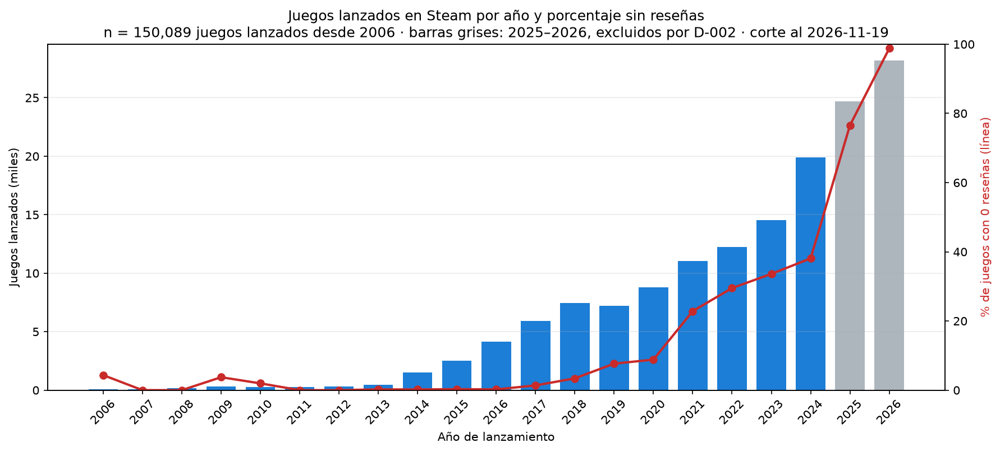
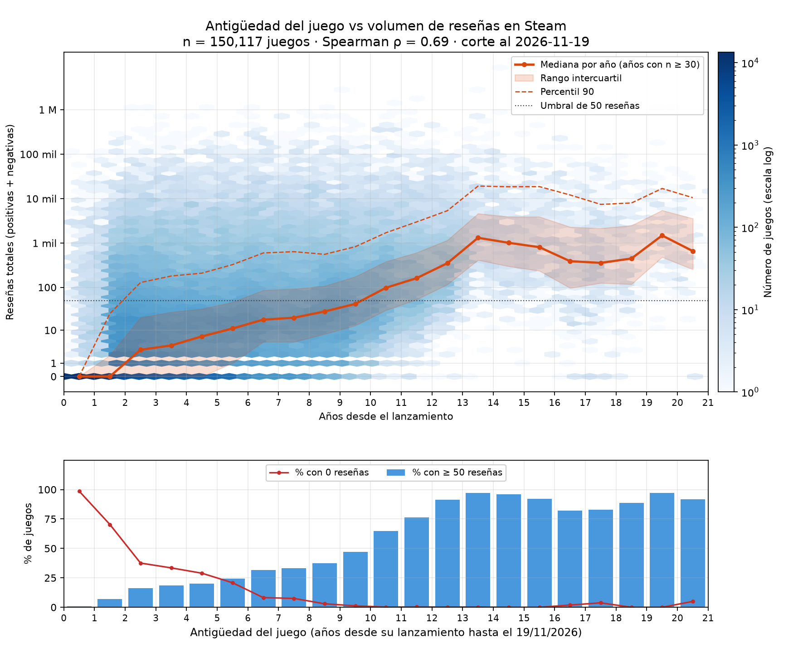
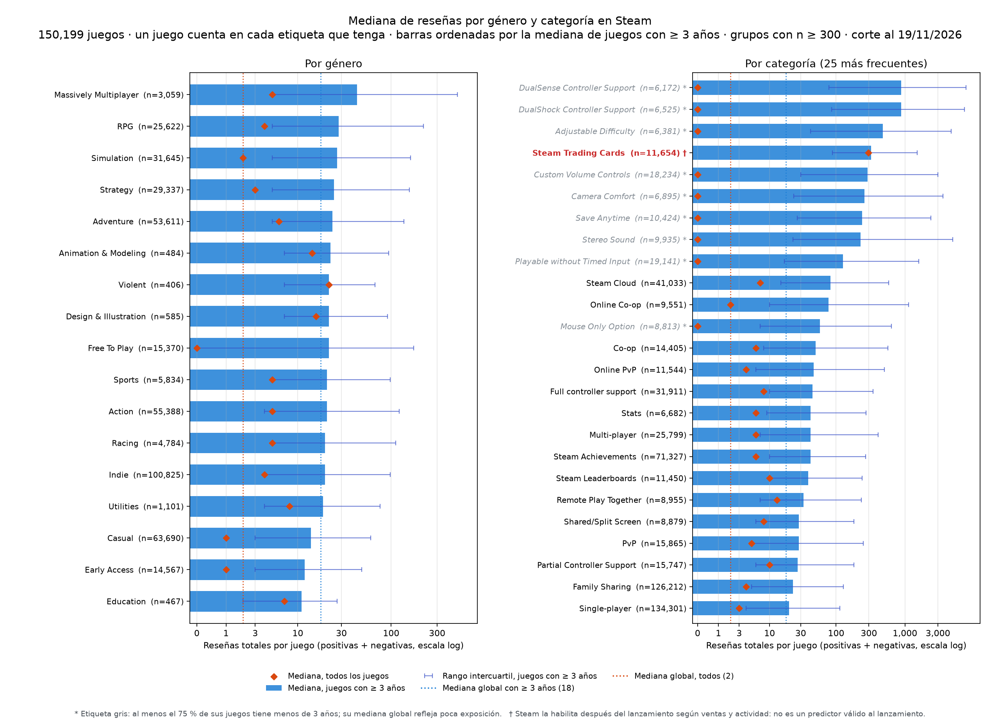
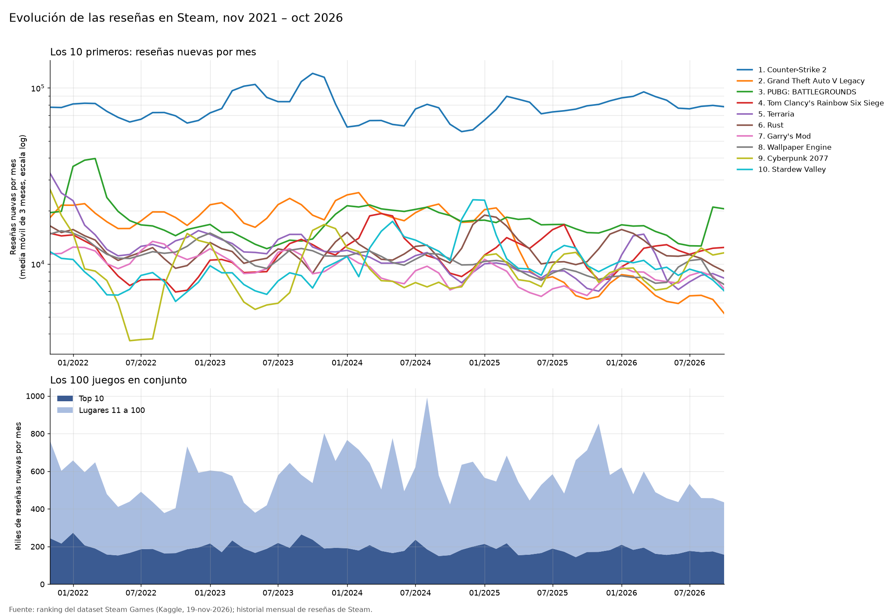
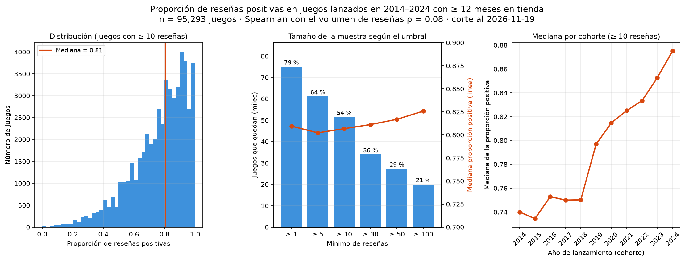

# Análisis exploratorio de datos

Este documento resume lo que muestran los datos de Steam antes de limpiarlos y modelarlos. Se centra en tres preguntas: qué tan completo es el conjunto, cuánto pesa la antigüedad del juego en las métricas de éxito y cómo se comporta la variable objetivo que eligió el equipo, la **proporción de reseñas positivas** (decisión D-003 en [acuerdos](equipo/acuerdos.md#decisiones-vigentes)).

Las columnas y su momento (Id, Pre, Pre\*, Post) están descritas en el [diccionario de datos](02-diccionario-datos.md). Lo que se hará con cada una está en la [estrategia de limpieza](04-estrategia-limpieza.md).

> [!info] Datos y reproducción
> - **Fuente:** [Steam Games Dataset – All Games](https://www.kaggle.com/datasets/hubertsidorowicz/steam-games-dataset-daily-updates) (Kaggle, licencia MIT), descarga del **2026-11-19**. Todas las antigüedades se calculan contra esa fecha de corte.
> - **Notebooks:** cada sección indica el notebook que genera sus cifras y gráficas. Los notebooks buscan el archivo en `data/raw/steam_games.csv.gz`, en la carpeta `Proyecto Final/Datos/` o en la variable de entorno `STEAM_GAMES_CSV`.
> - **Salidas:** las gráficas se guardan en `reports/figures/` y las tablas en `reports/metrics/`.

## Notebooks

| Notebook | Contenido | Origen |
|---|---|---|
| [02_eda](../notebooks/02_eda.ipynb) | Resumen del conjunto, ceros que significan «sin dato», lanzamientos por año y variable objetivo | Nuevo |
| [02a_antiguedad_resenas](../notebooks/02a_antiguedad_resenas.ipynb) | Antigüedad del juego vs volumen de reseñas | Script `antiguedadVsResenas.py` (eliminado) |
| [02b_percentiles_cohorte](../notebooks/02b_percentiles_cohorte.ipynb) | Percentiles dentro de la cohorte de lanzamiento | Script `percentilesPorCohorte.py` (eliminado) |
| [02c_resenas_genero_categoria](../notebooks/02c_resenas_genero_categoria.ipynb) | Mediana de reseñas por género y por categoría | Script `medianaResenasPorGenero.py` (eliminado) |
| [02d_evolucion_top100](../notebooks/02d_evolucion_top100.ipynb) | Evolución mensual de los 100 juegos con más recomendaciones | Script `evolucion_top100_recomendaciones.py` (eliminado) |

## Resumen del conjunto

*Notebook:* [02_eda](../notebooks/02_eda.ipynb)

| Concepto | Juegos | % |
|---|---:|---:|
| Filas de `steam_games.csv` (42 columnas) | 150,199 | 100.0 |
| Con fecha de lanzamiento válida | 150,117 | 99.9 |
| Sin ninguna reseña (`positive + negative = 0`) | 67,108 | 44.7 |
| Lanzados en 2025 o 2026 | 52,856 | 35.2 |
| Con al menos 12 meses en tienda | 119,183 | 79.4 |
| Sin datos de la tienda (`steam_store_available = False`) | 14 | 0.0 |

- **Precio:** 120,128 juegos son de pago, 28,651 gratuitos y 1,420 ya no se pueden comprar (`price_status = unavailable`). La mediana del precio es de 4.99 USD. El máximo, 107,500 USD, es un error de captura que se eliminará (D-004).
- **Lectura del archivo:** hay que usar `keep_default_na=False`. Si no, pandas convierte en nulo el nombre del juego «NULL» y el texto «None» de `notes`.
- **Formatos mixtos:** `genres`, `categories`, `tags`, `supported_languages` y `estimated_owners` mezclan dos formatos en la misma columna (texto y objetos JSON). Hay que unificarlos antes de contar etiquetas.

### Ceros que significan «sin dato»

En estas columnas, un 0 no es un valor real. Por eso solo sirven, a lo más, para validar resultados y no como variables objetivo ni predictoras.

| Columna | Sin dato | % |
|---|---:|---:|
| `estimated_owners` (rango `0 - 0`) | 21,089 | 14.04 |
| `recommendations` (Steam solo la publica a partir de 100) | 127,814 | 85.10 |
| `peak_ccu` | 130,511 | 86.89 |
| `average_playtime_forever` / `median_playtime_forever` | 140,973 | 93.86 |
| `metacritic_score` | 145,900 | 97.14 |
| `average_playtime_2weeks` / `median_playtime_2weeks` | 148,371 | 98.78 |
| `user_score` | 150,130 | 99.95 |

Tabla completa: `reports/metrics/02_eda_ceros_sin_dato.csv`.

## Distribuciones univariadas

### Lanzamientos por año

El catálogo crece de forma casi exponencial. Entre 2025 y 2026 se lanzó más de un tercio de todos los juegos del conjunto. La proporción de juegos sin reseñas sube con fuerza en los años recientes: es casi 0 % antes de 2017, sube a entre 22 % y 38 % en 2021–2024, y llega a 77 % en 2025 y 99 % en 2026.

> [!warning] Ceros sospechosos en 2021–2024
> Que haya entre 22 % y 38 % de juegos sin reseñas en cohortes que llevan de 2 a 5 años en tienda no se explica solo por la falta de exposición. Pueden ser datos de SteamSpy sin actualizar. Antes de fijar la muestra hay que comparar una muestra de estos juegos contra la tienda.

### Volumen de reseñas

El volumen de reseñas (`positive + negative`) está extremadamente sesgado: la mediana global es de 2 reseñas, pero el juego con más reseñas acumula unos 8.8 millones. Por eso todas las gráficas de volumen usan escala logarítmica.

## Relaciones bivariadas

### Antigüedad vs volumen de reseñas

*Notebook:* [02a_antiguedad_resenas](../notebooks/02a_antiguedad_resenas.ipynb)

- **La relación es fuerte:** la correlación de Spearman entre antigüedad y número de reseñas es de 0.69 (150,117 juegos).
- **Los juegos recientes casi no tienen reseñas:** de los que tienen menos de un año, el 98.6 % tiene 0. Hasta los 5 años, menos del 25 % llega a 50 reseñas.
- **Un umbral fijo de 50 reseñas se alcanza tarde:** la mediana pasa de 50 reseñas hasta los 9–10 años. Entre los 12 y 15 años, más del 90 % de los juegos lo supera.
- **Consecuencia:** un mínimo fijo de reseñas deja fuera sobre todo a los juegos recientes, y la muestra se carga hacia los títulos antiguos.

### Percentiles dentro de la cohorte de lanzamiento

*Notebook:* [02b_percentiles_cohorte](../notebooks/02b_percentiles_cohorte.ipynb)

Para neutralizar la exposición, cada juego se compara solo con los lanzados el mismo año. Se excluyen los juegos con menos de 12 meses en tienda (30,934) y los que no tienen fecha o conteo de reseñas (82). Así quedan 119,183 juegos. Los años con menos de 200 juegos se agrupan en la cohorte «≤2008».

| Medida | Spearman con la antigüedad |
|---|---:|
| Reseñas totales (crudas) | 0.555 |
| Percentil global | 0.555 |
| **Percentil dentro de la cohorte** | **0.006** |

| Cohorte | n | % con 0 | p50 | p75 | p90 | Mediana % positivas |
|---|---:|---:|---:|---:|---:|---:|
| 2013 | 467 | 0.2 | 1,170 | 4,231 | 17,663 | 0.79 |
| 2014 | 1,521 | 0.2 | 316 | 1,088 | 4,889 | 0.74 |
| 2016 | 4,137 | 0.2 | 88 | 344 | 1,469 | 0.75 |
| 2018 | 7,449 | 3.4 | 27 | 103 | 559 | 0.75 |
| 2020 | 8,790 | 8.8 | 18 | 81 | 562 | 0.81 |
| 2022 | 12,254 | 29.5 | 6 | 31 | 202 | 0.83 |
| 2024 | 19,898 | 38.1 | 3 | 19 | 122 | 0.88 |
| 2025 | 21,922 | 74.0 | 0 | 1 | 20 | 0.90 |

Tabla completa, año por año: `reports/metrics/percentilesCohorte_resumen.csv`.

- **El percentil por cohorte elimina la tendencia con la antigüedad:** la correlación baja de 0.555 a 0.006, y cada cohorte conserva 25 % de sus juegos en el cuartil superior.
- **Un umbral fijo no sirve:** para estar en el cuartil superior hacen falta unas 4,231 reseñas en 2013 y solo 19 en 2024.
- **Las cohortes anteriores a 2014 son atípicas:** son pocas y reflejan un catálogo curado, anterior a Steam Greenlight y a la apertura de la tienda.
- **La cohorte 2025 no es fiable:** 74 % de sus juegos tiene 0 reseñas, su p75 es de 1 reseña y la antigüedad todavía influye dentro del año (ρ = 0.51). En las demás cohortes esa correlación está entre −0.16 y 0.20. Esto respalda la decisión D-002 de excluir 2025 y 2026.

### Reseñas por género y por categoría

*Notebook:* [02c_resenas_genero_categoria](../notebooks/02c_resenas_genero_categoria.ipynb)

Un juego cuenta en cada género o categoría que tenga. Las barras muestran la mediana de los juegos con al menos 3 años en tienda, y los rombos la de todos los juegos. Solo se grafican los grupos con al menos 300 juegos.

- **La antigüedad pesa más que cualquier etiqueta:** la mediana global es de 2 reseñas con todos los juegos y de 18 con los que tienen al menos 3 años.
- **Géneros:** entre los juegos con al menos 3 años, las diferencias son moderadas. Massively Multiplayer tiene la mediana más alta (44), seguido de RPG (28) y Simulation (27). Casual (14), Early Access (12) y Education (11) quedan al final.
- **Categorías:** las de multijugador y las de servicios de Steam (Steam Cloud, Co-op, Online PvP) superan a Single-player y Family Sharing, que casi todos los juegos tienen.
- **Categorías recientes (en gris):** etiquetas como DualSense Controller Support o Adjustable Difficulty tienen al menos 75 % de juegos con menos de 3 años, así que su mediana global refleja poca exposición.
- **Steam Trading Cards no es un predictor:** tiene la mediana más alta, pero [Steamworks](https://partner.steamgames.com/doc/marketing/profile) la habilita después del lanzamiento según ventas y actividad. Es consecuencia del éxito, no causa.
- **Etiquetas comerciales y software:** Indie, Early Access y Free To Play son etiquetas comerciales y se separan de los géneros (D-005). Utilities, Design & Illustration, Animation & Modeling y Education identifican software que no es juego.

### Evolución de los 100 juegos con más recomendaciones

*Notebook:* [02d_evolucion_top100](../notebooks/02d_evolucion_top100.ipynb)

El conjunto es una sola fotografía al 2026-11-19, así que no trae historia. El ranking se tomó de `recommendations`, y la evolución mensual del histograma de reseñas que publica Steam para cada juego. El historial se descargó el 2026-11-22 y se guarda en `data/interim/` para que las gráficas sean reproducibles.

- **Los lanzamientos exitosos concentran sus reseñas al inicio:** juegos como Black Myth: Wukong, HELLDIVERS 2, Palworld o Baldur's Gate 3 tienen un pico muy fuerte el mes de salida y luego bajan. Las franjas grises son los meses previos a cada lanzamiento.
- **Los veteranos se mantienen:** Counter-Strike 2 recibe entre 54,000 y 158,000 reseñas al mes (mediana de unas 76,000), varias veces más que cualquier otro juego.
- **El total del top 100 no crece:** suma entre 380,000 y 990,000 reseñas al mes, con picos cuando sale un juego grande. Los 10 primeros aportan entre 140,000 y 270,000.
- **Implicación:** el volumen de reseñas premia tanto el tiempo en tienda como el éxito, lo que refuerza usar la proporción de positivas como objetivo.

## Variable objetivo

*Notebook:* [02_eda](../notebooks/02_eda.ipynb)

La variable objetivo acordada es la proporción de reseñas positivas:

$$\text{positiveRatio} = \frac{positive}{positive + negative}$$

Se analiza sobre el universo que el equipo propone para el modelo: cohortes 2014–2024 (D-002) con al menos 12 meses en tienda. Son 95,293 juegos.

### Por qué la proporción y no el volumen

En la exploración previa (nota «Determinación de variable objetivo», 2026-11-20) se compararon las variables Post como candidatas a medir el éxito:

| Variable | Qué mide | Juegos con dato real | Veredicto |
|---|---|---:|---|
| `positive + negative` | Volumen de reseñas (alcance) | 69 % | Mejor medida de alcance comercial; Spearman de 0.72 con los propietarios estimados, pero depende de la antigüedad |
| $\frac{positive}{positive+negative}$ | Recepción | 67 % | Mejor medida de calidad percibida; Spearman de 0.58 con Metacritic |
| `estimated_owners` | Propietarios estimados | rangos | Poco detalle: 83 % de los juegos cae en «0» o «0–20,000» |
| `peak_ccu` | Jugadores simultáneos del día anterior | 16 % | Mide la actividad actual y castiga a los juegos para un solo jugador |
| `recommendations` | Recomendaciones | 17 % | Repite las reseñas y solo se publica a partir de 100 |
| `metacritic_score` | Crítica | 3.6 % | Muy poca cobertura; solo para validar |

Las cifras de esta tabla se calcularon con los 119,095 juegos que tenían al menos un año en tienda.

### Distribución y umbral mínimo de reseñas

| Mínimo de reseñas | Juegos | % del universo | Mediana | Media | % con proporción < 0.5 |
|---:|---:|---:|---:|---:|---:|
| ≥ 1 | 75,007 | 78.7 | 0.810 | 0.751 | 12.2 |
| ≥ 5 | 61,092 | 64.1 | 0.802 | 0.761 | 10.1 |
| ≥ 10 | 51,499 | 54.0 | 0.807 | 0.767 | 8.8 |
| ≥ 30 | 33,959 | 35.6 | 0.811 | 0.776 | 6.9 |
| ≥ 50 | 27,248 | 28.6 | 0.817 | 0.783 | 6.0 |
| ≥ 100 | 19,954 | 20.9 | 0.826 | 0.794 | 4.9 |

Tabla: `reports/metrics/02_eda_umbral_resenas.csv`.

- **Distribución sesgada a la izquierda:** con al menos 10 reseñas, la mediana es de 0.81 y la mitad central de los juegos queda entre 0.67 y 0.91. Hay picos en valores como 0.5, 0.67 o 1.0, que aparecen cuando el número de reseñas es pequeño.
- **Casi independiente del volumen:** la correlación de Spearman entre volumen de reseñas y proporción positiva es de 0.08. Miden cosas distintas, así que la proporción no hereda el sesgo de exposición del volumen.
- **El umbral define el tamaño de la muestra:** con un mínimo de 10 reseñas queda poco más de la mitad del universo, y con 50 menos de un tercio. Subir el umbral eleva un poco la proporción media, porque los juegos con muchas reseñas tienden a estar mejor valorados. Estas cifras son la base para cerrar el acuerdo A-003 y la decisión [0002](decisiones/0002-minimo-de-resenas.md).
- **La proporción cambia entre cohortes:** la mediana sube de 0.74 en 2014 a 0.88 en 2024, con un salto en 2019. Hay que comparar cada juego contra su cohorte (percentil de la proporción) o incluir el año como control. Si no, el modelo aprendería que «más reciente» es «mejor valorado».
- **Ruido con pocas reseñas:** un juego con 3 de 3 reseñas positivas obtiene 1.0. Además del umbral, conviene evaluar el límite inferior de Wilson como alternativa más estable.

## Hallazgos principales

1. **La antigüedad domina las métricas de volumen.** El número de reseñas, los propietarios y las recomendaciones se acumulan con el tiempo (ρ = 0.69 con la antigüedad). Ninguna comparación entre juegos de distintos años es justa sin normalizar por cohorte.
2. **La proporción de positivas es una buena variable objetivo.** Cubre a dos tercios de los juegos con al menos un año en tienda, casi no depende del volumen (ρ = 0.08) y responde a la pregunta de qué tan bien se recibe un juego. Aun así, su mediana sube entre cohortes, así que también hay que controlar el año.
3. **El universo de modelado son las cohortes 2014–2024.** Antes de 2014 el catálogo era pequeño y curado. 2025 y 2026 no tienen exposición suficiente: 77 % y 99 % de sus juegos no tienen reseñas.
4. **El umbral mínimo de reseñas es un compromiso entre tamaño y ruido.** Con 10 reseñas quedan unos 51,500 juegos y con 50 unos 27,200. La elección debe tomarse en equipo (A-003) y probarse en la validación del modelo.
5. **Hay que auditar los ceros recientes.** Entre 22 % y 38 % de los juegos de 2021–2024 no tiene reseñas. Si son datos sin actualizar, esos juegos deben salir de la muestra y no contarse como fracasos.
6. **Varias variables son Post y producen fuga de información.** Steam Trading Cards, `tags`, `recommendations`, `peak_ccu` y los tiempos de juego aparecen después del éxito o se alimentan de él, así que no pueden ser predictores.
7. **Los géneros diferencian poco por sí solos.** Las diferencias en volumen de reseñas entre géneros son moderadas cuando se controla la exposición. Su efecto sobre la proporción de positivas todavía no se ha medido.

## Hallazgos del equipo

Hallazgos que se presentaron en la [sesión del 2026-11-22](equipo/sesiones/2026-11-22-exploracion-de-datos.md). Los EDA individuales están en `por-clasificar/` y todavía no se integran en estos notebooks:

- **Diana** ([notebook](../por-clasificar/diana/2026-11-24-eda-steam.ipynb)): las listas vacías (`[]`) no aparecen como NA, y hay faltantes relevantes en `metacritic_score` y `recommendations`. También calcula los juegos previos de cada desarrollador, con control de fuga (A-004).
- **Luis** ([notebook](../por-clasificar/luis/2026-11-23-eda-steam-v1.ipynb)): hay 94,963 desarrolladores únicos, con mucha concentración en pocos estudios (por ejemplo, Erotic Games Club tiene 237 juegos). Propuso analizar los idiomas contra la proporción positiva con un diagrama de dispersión (A-007).
- **En conjunto:** hay unos 80,000 publishers, demasiados para usar el nombre directamente (D-006). Hay hasta 103 idiomas registrados, con casos atípicos.
- **Alejandra:** hay unos 45 % de juegos sin reseñas y 82 fechas inválidas. Propuso un mínimo de 5 reseñas y un posible filtro desde 2019.

## Pendientes

- [ ] Auditar contra la tienda una muestra de los juegos de 2021–2024 con 0 reseñas.
- [ ] Medir la proporción de positivas por género, etiqueta comercial, precio, idiomas y plataforma (A-007), dentro de cada cohorte.
- [ ] Explorar las variables derivadas del historial del desarrollador y del publisher (A-004, D-006, D-009), calculadas solo con sus juegos anteriores.
- [ ] Fijar el umbral mínimo de reseñas (A-003, decisión [0002](decisiones/0002-minimo-de-resenas.md)) y la partición temporal (decisión [0003](decisiones/0003-particion-temporal.md)).
- [ ] Integrar los EDA de Diana, Luis y Alejandra cuando el equipo los clasifique.
